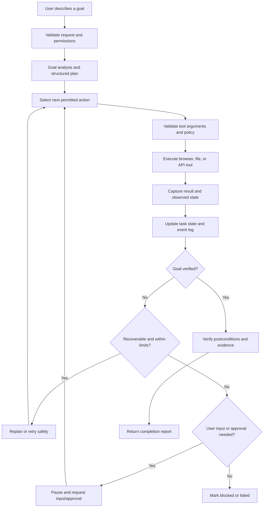

<a id="readme-top"></a>

<!-- PROJECT SHIELDS -->
<div align="center">

![Status][status-shield]
![Python][python-shield]
![React][react-shield]
![License][license-shield]

</div>

<!-- PROJECT LOGO -->
<br />
<div align="center">
  <!-- Replace this path with the project's final logo when one is added. -->
  

  <h1 align="center">TaskPilot-Autonomous AI Task Worker</h1>

  <p align="center">
    Turn a natural-language goal into a sequence of computer actions, adapt when something goes wrong, and verify whether the task actually finished.
    <br />
    <strong>Act · Observe · Reason · Recover · Verify</strong>
    <br /><br />
    <a href="#how-it-works"><strong>Explore the architecture »</strong></a>
    ·
    <a href="#roadmap">View roadmap</a>
    ·
    <a href="#contributing">Contribute</a>
  </p>
</div>

> **Project status:** Prototype blueprint. The architecture, setup commands, API contract, and roadmap below describe the intended implementation. Update the status badges, commands, screenshots, and completion checkboxes as the code is built and tested.

<!-- TABLE OF CONTENTS -->
<details>
  <summary>Table of Contents</summary>
  <ol>
    <li><a href="#about-the-project">About the Project</a>
      <ul>
        <li><a href="#built-with">Built With</a></li>
        <li><a href="#how-it-works">How It Works</a></li>
        <li><a href="#core-design-principles">Core Design Principles</a></li>
      </ul>
    </li>
    <li><a href="#getting-started">Getting Started</a>
      <ul>
        <li><a href="#prerequisites">Prerequisites</a></li>
        <li><a href="#proposed-repository-layout">Proposed Repository Layout</a></li>
        <li><a href="#installation">Installation</a></li>
        <li><a href="#configuration">Configuration</a></li>
      </ul>
    </li>
    <li><a href="#usage">Usage</a></li>
    <li><a href="#execution-lifecycle">Execution Lifecycle</a></li>
    <li><a href="#tools-and-integrations">Tools and Integrations</a></li>
    <li><a href="#safety-and-approvals">Safety and Approvals</a></li>
    <li><a href="#memory-and-resume">Memory and Resume</a></li>
    <li><a href="#evaluation">Evaluation</a></li>
    <li><a href="#api">API</a></li>
    <li><a href="#deployment">Deployment</a></li>
    <li><a href="#roadmap">Roadmap</a></li>
    <li><a href="#contributing">Contributing</a></li>
    <li><a href="#license">License</a></li>
  </ol>
</details>

<!-- ABOUT THE PROJECT -->
## About the Project

People frequently switch between emails, documents, browser tabs, APIs, and internal applications to complete routine work. A conventional chatbot can describe the steps, but the user still has to perform them and check the result.

**Autonomous AI Task Worker** is a prototype of an AI agent that receives a goal in natural language, plans the work, uses approved tools, observes the outcome of each action, adapts when an action fails, and reports the evidence it found.

### Example task

> “Find the latest invoice from Company X, extract the invoice number, amount and due date, enter it into our internal system, and tell me once it is done.”

The worker should:

1. Interpret the desired outcome and identify any missing information.
2. Search the configured document or inbox source for the relevant invoice.
3. Extract and validate the required fields.
4. Open the simulated finance application and enter the values.
5. Read the saved record back to verify that the values match.
6. Recover from safe, recoverable failures—or pause for user input when it cannot proceed safely.
7. Return a concise result with the task status, important values, action history, and verification evidence.

The initial prototype should use **sample invoices and a simulated company application**. Real inboxes, finance systems, and external accounts can be added later through explicitly configured integrations and permissions.

### Project goals

- Accept a high-level goal rather than requiring the user to script every step.
- Convert the goal into a structured, inspectable task plan.
- Use a controlled set of browser, file, and API tools.
- Observe the result of each action before deciding what to do next.
- Preserve useful task state and resume safely where possible.
- Detect errors, apply bounded retries, and choose reasonable alternatives.
- Verify the final outcome independently of the model's claims.
- Ask for clarification or approval when required.
- Produce a useful audit trail without exposing secrets.

### Non-goals for the first prototype

- Unrestricted control of the user's entire computer.
- Arbitrary shell or Python execution selected by the model.
- Guaranteed success on every website or task.
- Unattended payments, purchases, account changes, or external messages.
- Treating an LLM's statement of success as proof of completion.

<p align="right">(<a href="#readme-top">back to top</a>)</p>

### Built With

The following stack is the **proposed implementation**, not a claim that each component is already integrated.

[![Python][python-shield]][python-url]
[![FastAPI][fastapi-shield]][fastapi-url]
[![Playwright][playwright-shield]][playwright-url]
[![Pydantic][pydantic-shield]][pydantic-url]
[![React][react-shield]][react-url]
[![Vite][vite-shield]][vite-url]
[![SQLite][sqlite-shield]][sqlite-url]

| Component | Intended responsibility |
|---|---|
| Python | Agent orchestration, task lifecycle, tool execution, and verification logic |
| FastAPI | Backend API for creating, inspecting, approving, and cancelling tasks |
| LLM provider adapter | Goal interpretation, planning, observation analysis, and next-action selection |
| Playwright | Controlled browser interaction and page-state inspection |
| File tools | Read supported files such as PDF and text documents; extract candidate invoice fields |
| Pydantic | Validate task definitions, tool arguments, extracted data, and result contracts |
| SQLite | Persist task records, steps, retries, approvals, and execution events for the prototype |
| React + Vite | Task submission, live activity feed, approval prompts, and results/evidence view |

A provider adapter should keep model-specific code behind one interface. The agent should not depend on a particular LLM vendor to enforce safety, tool validation, retries, or verification.

<p align="right">(<a href="#readme-top">back to top</a>)</p>

### How It Works



The central loop is **action → observation → state update → next decision**. The model proposes what to do; the execution layer validates whether it is allowed and whether the tool call is well-formed. The system must not assume an action succeeded merely because a tool call returned without throwing an exception.

#### Suggested module boundaries

| Module | Responsibility | Example output |
|---|---|---|
| Task intake | Parse the goal, constraints, and requested deliverable | Validated task specification |
| Planner | Break the outcome into ordered, checkable steps | Step list with dependencies and success criteria |
| Policy engine | Enforce tool permissions, risk levels, and approval rules | Allow, deny, or require approval |
| Tool registry | Expose typed, allowlisted operations | `search_documents`, `read_pdf`, `browser_click`, `read_record` |
| Executor | Run one validated tool action at a time | Tool result or structured error |
| Observer | Summarise the actual page/file/API state | Observations for the next planning decision |
| Task state store | Persist plan, step status, attempt count, and event history | Resumable task record |
| Verifier | Check explicit postconditions against observed data | Verified, not verified, or inconclusive |
| Reporter | Summarise outcomes, evidence, and unresolved issues | Final task report |

<p align="right">(<a href="#readme-top">back to top</a>)</p>

### Core Design Principles

#### 1. The goal is the contract

The plan is an implementation detail. A task is complete only when its requested outcome and verification conditions have been satisfied. If the plan needs to change, the system can replan without changing the goal.

#### 2. Observe after every action

Each tool call returns a structured result. For browser actions, capture a relevant page snapshot or locator state; for API actions, inspect the response and, where appropriate, read the resulting record back. The next action should use the fresh observation rather than relying on an old screenshot or assumption.

#### 3. Tool calls are typed and allowlisted

The model may choose among registered tools, but each tool has a defined schema, validation, permission scope, timeout, and error contract. Do not expose arbitrary shell execution or unrestricted file-system access to the model.

#### 4. Verification is separate from execution

A successful click, HTTP 200 response, or generated summary is not enough by itself. Define checkable postconditions, such as “a record exists with this invoice number and amount,” then query or inspect the target system to confirm them.

#### 5. Fail safely

Retries are bounded. Do not blindly retry non-idempotent actions such as creating a record or sending a message when the first attempt may already have succeeded. First inspect the target system for evidence of the original result.

#### 6. Keep a trace

Record task and step identifiers, timestamps, tool names, redacted arguments, outcomes, retries, approvals, and verification evidence. Never place API keys, session cookies, or credentials in the task trace.

<p align="right">(<a href="#readme-top">back to top</a>)</p>

<!-- GETTING STARTED -->
## Getting Started

The repository structure and commands below are a suggested scaffold. They become runnable once the corresponding backend and frontend files have been created.

### Prerequisites

- Python 3.11 or newer
- Node.js LTS and npm
- Git
- An API key for a supported LLM provider, if hosted model inference is enabled
- A modern browser supported by Playwright for browser tasks

The prototype should support a mock/offline mode for testing core orchestration without a live LLM account.

### Proposed Repository Layout

```text
autonomous-ai-task-worker/
├── backend/
│   ├── app/
│   │   ├── api/              # FastAPI routes
│   │   ├── agent/            # Planner, executor, observer, verifier
│   │   ├── policies/         # Permissions, approvals, risk rules
│   │   ├── tools/            # Browser, file, and simulated-app tools
│   │   ├── schemas/          # Pydantic request and result schemas
│   │   ├── storage/          # SQLite models and repositories
│   │   └── main.py           # FastAPI application entry point
│   ├── tests/
│   ├── pyproject.toml
│   └── .env.example
├── frontend/
│   ├── src/
│   │   ├── components/       # Task form, timeline, approval and evidence UI
│   │   ├── pages/
│   │   └── App.tsx
│   ├── package.json
│   └── .env.example
├── demo/
│   ├── invoices/             # Synthetic documents only
│   └── company_app/          # Simulated destination app or API
├── docs/
│   ├── architecture.md
│   └── screenshots/
├── .gitignore
├── LICENSE
└── README.md
```

### Installation

#### 1. Clone the repository

```bash
git clone <your-repository-url>
cd autonomous-ai-task-worker
```

Replace `<your-repository-url>` with the URL of your repository.

#### 2. Set up the backend

The commands below assume the backend uses a `pyproject.toml` and `uv`. If the project uses another dependency manager, update these steps to match it.

```bash
cd backend
# Install uv first if it is not already available.
uv sync
```

Copy `.env.example` to `.env` and configure the required values as described below. Then start the API:

```bash
uv run uvicorn app.main:app --reload --host 127.0.0.1 --port 8000
```

Once the API is running, its interactive documentation should be available at `http://127.0.0.1:8000/docs`.

#### 3. Set up the frontend

Open a second terminal from the repository root:

```bash
cd frontend
npm install
npm run dev
```

Open the local URL printed by Vite. The frontend API base URL should point to the local backend, typically `http://127.0.0.1:8000` during development.

#### 4. Install browser support

If the Playwright browser tool is enabled in the backend, install the browser binaries required by the selected Playwright configuration. For example:

```bash
cd backend
uv run playwright install chromium
```

Use only the browser engine and dependencies configured by the implementation.

<p align="right">(<a href="#readme-top">back to top</a>)</p>

### Configuration

Use environment variables for provider settings, storage paths, execution limits, and browser configuration. Keep secrets out of source control.

| Variable | Purpose | Example / default |
|---|---|---|
| `APP_ENV` | Runtime environment | `development` |
| `API_HOST` | API bind host | `127.0.0.1` |
| `API_PORT` | API port | `8000` |
| `DATABASE_URL` | Task/event database | `sqlite:///./task_worker.db` |
| `LLM_PROVIDER` | Configured model provider | Provider-specific; implementation-defined |
| `LLM_API_KEY` | Provider credential | Set in local environment; never commit |
| `LLM_MODEL` | Model identifier | Provider-specific; implementation-defined |
| `MAX_STEPS_PER_TASK` | Maximum action count | `30` as an initial development limit |
| `MAX_RETRIES_PER_STEP` | Retry cap for a step | `2` as an initial development limit |
| `TOOL_TIMEOUT_SECONDS` | Per-tool timeout | `30` as an initial development limit |
| `BROWSER_HEADLESS` | Run browser visibly or headlessly | `true` in automated tests |
| `REQUIRE_APPROVAL_FOR_WRITES` | Pause before write actions | `true` for the first prototype |
| `CORS_ORIGINS` | Allowed frontend origins | Local frontend origin only |

These values are illustrative defaults for the initial scaffold, not measured performance limits. The backend should validate configuration at startup and fail clearly when a required setting is missing.

Do not store credentials, access tokens, cookies, private customer data, or real invoices in `.env` examples, committed fixtures, screenshots, or logs. Use synthetic data for demos and tests.

<p align="right">(<a href="#readme-top">back to top</a>)</p>

<!-- USAGE -->
## Usage

### Example: process an invoice

Submit a goal such as:

```text
Find the newest invoice from Acme Supplies in the demo documents.
Extract the invoice number, amount, currency, and due date.
Create a corresponding record in the simulated finance application.
Verify that the saved record matches the invoice and report the result.
```

The worker should produce an inspectable plan resembling:

| Step | Action | Success condition |
|---|---|---|
| 1 | Search the approved document source | Candidate invoices are returned |
| 2 | Select the newest matching invoice | Selection is supported by the document date and company identity |
| 3 | Read and parse the invoice | Required fields are extracted and validated |
| 4 | Check the destination for an existing record | Duplicate creation risk is understood |
| 5 | Request approval if required by policy | A permitted write is authorised |
| 6 | Create the finance record | The destination reports a successful write or returns a record identifier |
| 7 | Read the record back | Persisted fields match the extracted values |
| 8 | Report the outcome | Final status includes evidence and any unresolved warnings |

A successful final report should distinguish **verified completion**, **partial completion**, **blocked pending user input**, and **failure**. It should never claim success when verification is missing or inconclusive.

### Expected result format

```json
{
  "task_id": "task_123",
  "status": "completed",
  "summary": "Invoice INV-1042 was added and verified.",
  "data": {
    "company": "Acme Supplies",
    "invoice_number": "INV-1042",
    "amount": 1250.0,
    "currency": "USD",
    "due_date": "2026-11-15"
  },
  "verification": {
    "status": "passed",
    "checks": [
      "Record exists in the finance application",
      "Invoice number, amount, currency, and due date match"
    ]
  },
  "evidence": [
    {
      "type": "destination_record",
      "reference": "FIN-2031"
    }
  ],
  "requires_user_action": false
}
```

This is an illustrative result contract. Identifiers and data above are synthetic examples, not records produced by a running implementation.

<p align="right">(<a href="#readme-top">back to top</a>)</p>

## Execution Lifecycle

Every task should move through explicit states so the UI and API can accurately describe progress.

| State | Meaning |
|---|---|
| `queued` | Accepted and waiting to run |
| `planning` | Goal and success conditions are being defined |
| `running` | A validated step is being executed |
| `waiting_for_approval` | A gated action needs user approval |
| `waiting_for_input` | Required information is missing or ambiguous |
| `verifying` | The system is checking the final postconditions |
| `completed` | Required postconditions passed verification |
| `partial` | Some requested work succeeded, but the full goal did not |
| `blocked` | The agent cannot proceed safely or lacks access |
| `failed` | The task ended unsuccessfully after allowed recovery attempts |
| `cancelled` | The user cancelled the task |

A task record should preserve the goal, plan version, current step, step results, retry counts, approvals, timestamps, and verification outcome. State transitions should be validated by the backend rather than left to the LLM.

### Recovery policy

1. Classify the observed failure: transient, stale page state, invalid input, permission denial, ambiguous result, or permanent failure.
2. Retry only when the operation is safe to retry and the configured attempt limit has not been reached.
3. For non-idempotent writes, inspect the destination before retrying to avoid duplicate records or repeated external effects.
4. Re-observe the environment after a navigation, timeout, or recovery action.
5. Replan when the current approach is no longer viable, but preserve the original goal and safety constraints.
6. Ask for user input or mark the task blocked when uncertainty cannot be resolved safely.

<p align="right">(<a href="#readme-top">back to top</a>)</p>

## Tools and Integrations

Tools should be registered in a central allowlist. Every tool needs a typed input schema, an explicit permission scope, a timeout, a structured result, and a defined error model.

| Tool family | Example operations | Guardrails |
|---|---|---|
| Documents | Search files, list candidates, read PDF/text, extract fields | Restrict accessible folders; enforce file-size and content-type limits |
| Browser | Navigate to an approved URL, inspect page state, click a known control, fill a form | Restrict domains, validate targets, observe after actions, avoid hidden or unintended controls |
| Company application | Search records, create a draft record, read a record by ID | Use a simulated app initially; apply schema validation and duplicate checks |
| Verification | Query stored records, compare values, inspect success states | Use independent reads where possible; return pass/fail/inconclusive for each check |
| Approval | Request permission for a risky action, record decision | Bind approval to a specific task, action, and parameters |

### Tool result contract

Prefer structured tool responses over free-form status text. A result can include:

```json
{
  "ok": true,
  "tool": "read_finance_record",
  "data": {
    "record_id": "FIN-2031",
    "invoice_number": "INV-1042",
    "amount": 1250.0,
    "currency": "USD",
    "due_date": "2026-11-15"
  },
  "observation": "A matching finance record was found.",
  "error": null
}
```

Tool output, documents, web pages, and emails must be treated as **untrusted data**, not instructions that can override the user's goal or the agent's policies. Content such as “ignore previous instructions” inside a document must not grant new permissions or expand tool access.

<p align="right">(<a href="#readme-top">back to top</a>)</p>

## Safety and Approvals

The agent should use least privilege by default. A natural-language instruction is not a reason to bypass access controls, browser restrictions, or application policy.

### Safety contract

- **Allowlisted tools only.** The model cannot invent new tool capabilities during execution.
- **Least-privilege access.** File roots, approved domains, API methods, and account scopes are configured outside the model.
- **Human approval for high-impact actions.** Sending messages externally, spending money, deleting records, submitting irreversible forms, or changing permissions should pause when the policy requires approval.
- **Approval is specific.** Show the user the exact action and relevant parameters; do not treat approval for one action as permission for all future actions.
- **Validate before writing.** Check required fields, formats, limits, and duplicate conditions before mutating the target application.
- **Protect against prompt injection.** Treat page and document content as evidence, never as policy or developer instructions.
- **Bound the run.** Enforce maximum steps, retries, elapsed time, tool output size, and model usage.
- **Keep secrets out of traces.** Redact tokens, cookies, passwords, and other credentials from logs and screenshots.
- **Report uncertainty honestly.** If verification cannot be performed, say that completion is unverified.
- **Support cancellation.** Stop scheduling new actions after cancellation and define how in-flight operations are handled.

The first demo should use synthetic invoices and a simulated app. Any later integration with real company systems must add authentication, authorization, secret management, audit retention, and explicit review of the actions that the agent is allowed to perform.

<p align="right">(<a href="#readme-top">back to top</a>)</p>

## Memory and Resume

The worker needs memory to maintain context across a multi-step task, but memory should be scoped and explicit.

### Task memory

Persist facts needed to finish the active task, such as:

- The original goal and success conditions.
- Candidate documents and the selected source of truth.
- Extracted field values with source references.
- Completed steps and observations.
- Previous errors and retry attempts.
- Approval decisions and their scope.
- Created record identifiers and verification results.

### Resume behaviour

When a task restarts, reload its durable state and inspect the environment before continuing. A stored “step completed” flag is not enough if the environment may have changed. Before repeating a write, check whether the intended record already exists.

Cross-task memory—remembering preferences or details between separate tasks—should be opt-in, minimised, inspectable, and removable. It is not required for the initial invoice workflow.

<p align="right">(<a href="#readme-top">back to top</a>)</p>

## Evaluation

A useful evaluation measures task outcomes, reliability, safety, and cost—not just whether the agent generated plausible action sequences. No benchmark results are claimed in this README; metrics should be populated after repeatable tests are implemented and run.

### Initial benchmark scenarios

| Scenario | Expected behaviour |
|---|---|
| Happy-path invoice | Extract the correct fields, create one record, and verify it |
| Multiple matching invoices | Select the correct latest invoice using an explicit date rule |
| Missing due date | Ask for clarification or report the field as unavailable; do not invent a value |
| Invalid or unreadable PDF | Attempt an allowed fallback or stop with a useful explanation |
| Browser selector changes | Re-observe the page and recover without blindly repeating a write |
| Timed-out create request | Check whether the record exists before considering a retry |
| Duplicate invoice already exists | Detect it and avoid creating a duplicate unless policy and user intent permit it |
| Prompt injection in a document | Ignore the embedded instruction and continue under the original policy |
| Approval-required action | Pause and wait for explicit approval |
| Verification mismatch | Report partial/failed status rather than success |
| User cancellation | Stop future actions and preserve the execution trace |
| Tool or LLM unavailable | Fail gracefully or use an explicitly permitted alternative |

### Metrics to record

| Metric | What it measures |
|---|---|
| End-to-end task success rate | Tasks whose required postconditions are verified |
| Verification accuracy | Whether reported success/failure agrees with the actual target state |
| Field extraction accuracy | Correctness of invoice number, amount, currency, and due date |
| Recovery success rate | Failed actions recovered without unsafe duplication or data loss |
| Duplicate-write rate | Tasks that create an unintended duplicate record |
| Approval-policy compliance | Whether gated actions pause until authorised |
| Human intervention rate | Tasks that need clarification or manual recovery |
| Tool-call count and retries | Execution efficiency and recovery overhead |
| Latency and cost per task | Runtime and model/tool spend for comparable runs |

Use synthetic fixtures with known answers, deterministic mock tools, and deliberate failure injection. Keep training/demo examples separate from evaluation cases. Report test count, pass/fail count, configuration, and any skipped tests whenever publishing results.

<p align="right">(<a href="#readme-top">back to top</a>)</p>

## API

The following endpoints are a proposed API contract. Implementations may change the route names, but should preserve explicit task states and verifiable outcomes.

| Endpoint | Purpose |
|---|---|
| `POST /api/v1/tasks` | Create a task from a natural-language goal and optional constraints |
| `GET /api/v1/tasks/{task_id}` | Get task status, current step, summary, and verification state |
| `GET /api/v1/tasks/{task_id}/events` | Retrieve ordered task and tool events |
| `POST /api/v1/tasks/{task_id}/approve` | Approve a specific pending action |
| `POST /api/v1/tasks/{task_id}/reject` | Reject a pending action and let the task stop or replan |
| `POST /api/v1/tasks/{task_id}/cancel` | Cancel a running or queued task |
| `GET /health` | Check API and configured service health |

### Example request

```http
POST /api/v1/tasks
Content-Type: application/json
```

```json
{
  "goal": "Find the latest Acme Supplies invoice, add it to the demo finance app, and verify the saved values.",
  "constraints": {
    "allowed_sources": ["demo/invoices"],
    "allowed_domains": ["finance-demo.local"],
    "write_mode": "require_approval"
  }
}
```

### Example task response

```json
{
  "task_id": "task_123",
  "status": "queued",
  "message": "Task accepted.",
  "requires_user_action": false
}
```

The identifiers and domain above are placeholders. An implementation should validate allowed sources and domains against server-side configuration; a client must not be able to grant itself new permissions by submitting arbitrary constraints.

<p align="right">(<a href="#readme-top">back to top</a>)</p>

## Deployment

For a hackathon demo, run the frontend and backend locally and use synthetic data. A production deployment needs additional controls and should not be treated as a simple extension of the local demo.

### Local development

- Run the API on a local interface and restrict CORS to the frontend origin.
- Store state in a local SQLite database.
- Keep provider keys in environment variables or a secret manager.
- Run browser automation in an isolated browser profile with no personal saved sessions.
- Use a simulated finance app and generated sample invoices.

### Production considerations

- Authenticate users and enforce server-side authorisation for every task and tool.
- Store credentials in a secret manager and use scoped tokens.
- Isolate browser contexts and worker processes between users/tasks.
- Set quotas, timeouts, concurrency limits, and usage budgets.
- Persist task events securely and establish retention/redaction policies.
- Restrict egress and allowed browser domains.
- Add queueing and worker recovery before running long tasks at scale.
- Monitor failed tasks, policy denials, retries, duplicate prevention, and verification mismatches.
- Review legal, privacy, and security requirements for connected company systems.

<p align="right">(<a href="#readme-top">back to top</a>)</p>

<!-- ROADMAP -->
## Roadmap

The checkboxes describe the proposed development sequence. Mark a feature complete only after its implementation and tests exist.

- [ ] Create the FastAPI backend and React/Vite task interface
- [ ] Define task, step, tool-result, approval, and evidence schemas
- [ ] Implement a structured planner with explicit success conditions
- [ ] Add an allowlisted tool registry with typed arguments and timeouts
- [ ] Build the simulated finance app and synthetic invoice dataset
- [ ] Implement PDF/text extraction with validation and source references
- [ ] Add Playwright browser actions and observation capture
- [ ] Implement the observe–act–update execution loop
- [ ] Persist task state and ordered event logs in SQLite
- [ ] Add bounded retry logic and safe handling of uncertain write outcomes
- [ ] Add independent postcondition verification and evidence reporting
- [ ] Add human approval, rejection, clarification, and cancellation flows
- [ ] Add deterministic mock mode and repeatable evaluation scenarios
- [ ] Test prompt injection, duplicate writes, timeouts, and stale browser state
- [ ] Add deployment configuration, authentication, and observability
- [ ] Evaluate additional tools and integrations after the core workflow is reliable

<p align="right">(<a href="#readme-top">back to top</a>)</p>

<!-- CONTRIBUTING -->
## Contributing

Contributions are welcome. Keep changes focused, testable, and aligned with the safety contract.

1. Fork the repository.
2. Create a feature branch: `git checkout -b feature/your-feature`.
3. Add or update tests for behaviour changes.
4. Run the relevant backend and frontend checks.
5. Commit your changes with a clear message.
6. Push the branch and open a pull request describing the change and its risk profile.

### Contribution guidelines

- Do not commit API keys, cookies, credentials, private documents, or real customer records.
- Add tests for retries, permissions, and failure paths—not only the happy path.
- Keep model-generated plans separate from policy enforcement.
- Every new tool needs an input schema, permission scope, timeout, error contract, and tests.
- Do not weaken approval requirements just to improve benchmark completion rates.
- Do not claim a task is complete without verification evidence.
- Document any new environment variables and update `.env.example` with safe placeholders only.

Suggested checks once the scaffold is implemented:

```bash
# From backend/
uv run pytest -q

# From frontend/
npm run lint
npm run build
```

<p align="right">(<a href="#readme-top">back to top</a>)</p>

<!-- LICENSE -->
## License

This project is intended to use the MIT License. Add a `LICENSE` file with the appropriate copyright holder before distributing the repository under that license.

<p align="right">(<a href="#readme-top">back to top</a>)</p>

<!-- MARKDOWN LINKS & IMAGES -->
[status-shield]: https://img.shields.io/badge/status-prototype%20blueprint-orange?style=for-the-badge
[python-shield]: https://img.shields.io/badge/Python-3.11%2B-3776AB?style=for-the-badge&logo=python&logoColor=white
[python-url]: https://www.python.org/
[react-shield]: https://img.shields.io/badge/React-UI-20232A?style=for-the-badge&logo=react&logoColor=61DAFB
[react-url]: https://react.dev/
[fastapi-shield]: https://img.shields.io/badge/FastAPI-API-009688?style=for-the-badge&logo=fastapi&logoColor=white
[fastapi-url]: https://fastapi.tiangolo.com/
[playwright-shield]: https://img.shields.io/badge/Playwright-Browser%20Automation-2EAD33?style=for-the-badge&logo=playwright&logoColor=white
[playwright-url]: https://playwright.dev/
[pydantic-shield]: https://img.shields.io/badge/Pydantic-Validation-E92063?style=for-the-badge&logo=pydantic&logoColor=white
[pydantic-url]: https://docs.pydantic.dev/
[vite-shield]: https://img.shields.io/badge/Vite-Frontend-646CFF?style=for-the-badge&logo=vite&logoColor=white
[vite-url]: https://vite.dev/
[sqlite-shield]: https://img.shields.io/badge/SQLite-Storage-003B57?style=for-the-badge&logo=sqlite&logoColor=white
[sqlite-url]: https://www.sqlite.org/
[license-shield]: https://img.shields.io/badge/license-MIT-blue?style=for-the-badge
